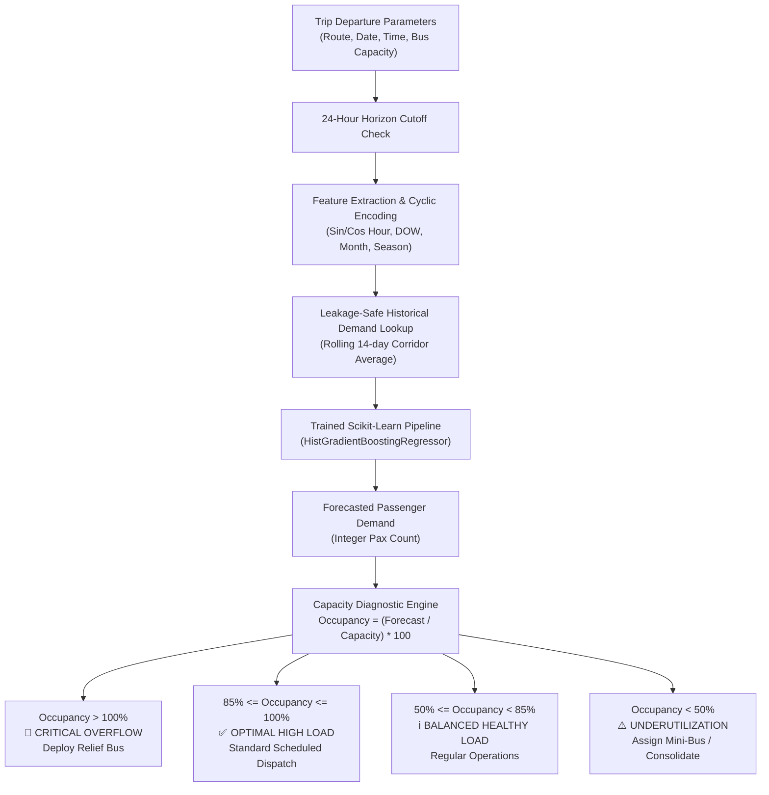

# 🚌 Bus Passenger-Demand Forecasting System

[](https://www.python.org/)
[](https://scikit-learn.org/)
[](https://streamlit.io/)
[](https://docs.pytest.org/)
[](https://opensource.org/licenses/MIT)

> **Assessment Submission:** Technical Assessment for AI & ML Internship  
> **Organization:** Algions AI Labs Private Limited  
> **Target Role:** Senior AI/ML Engineer & Full-Stack ML Developer  

---

## 📌 1. Project Overview & Business Value

Intercity bus operators struggle daily with unbalanced fleet utilization:
- **Underutilization (Empty Seats):** Buses operating with low passenger load incur full fuel, highway toll, and driver salary costs, directly burning operational margins.
- **Overcapacity (Spillover & Denied Boarding):** Unpredicted demand spikes cause terminal congestion, lost revenue, and severe customer dissatisfaction when passengers cannot be boarded.

This project delivers an end-to-end Machine Learning pipeline that forecasts passenger demand **24 hours prior to scheduled departure** at the granular trip level across 8 key northern Indian bus corridors.

### Core Business Capabilities
- **24-Hour Planning Horizon:** Provides fleet managers with the required 18–24 hour lead time to stage relief buses, reassign drivers, or adjust schedule frequencies.
- **Uncapped Latent Demand:** Unlike simplistic seat-filling models, our model predicts true latent demand without artificially capping predictions at bus capacity, revealing unserved passenger demand.
- **Actionable Capacity Diagnostics:** Automatically categorizes every departure into **Overcapacity (Spillover Risk)**, **High Utilization**, **Balanced**, or **Underutilization**, generating operational recommendations.



---

## 🛠️ 2. Technology Stack

- **Core ML & Data Engineering:** Python 3.11, Pandas 3.1, NumPy 2.4, Scikit-Learn 1.9, Joblib 1.6
- **Visualization:** Matplotlib 3.11, Seaborn 0.13
- **Web Application & UI:** Streamlit 1.67
- **Testing & Quality Assurance:** Pytest 9.2 (17 automated unit & integration tests)
- **Notebook Analytics:** Jupyter Notebook, nbconvert

---

## 📁 3. Modular Project Architecture

```
Bus-Passenger-Demand-Forecasting/
│
├── data/
│   ├── raw/
│   │   └── synthetic_bus_trips.csv         # 14,640 trip records (full calendar year)
│   └── processed/                          # Processed partitions
│
├── notebooks/
│   ├── 01_eda.ipynb                        # Executed EDA notebook with visualizations
│   └── create_eda_notebook.py              # Reproducible notebook generator
│
├── src/
│   ├── __init__.py
│   ├── data_generator.py                   # Reproducible synthetic trip generator (24h cutoff)
│   ├── preprocessing.py                    # Data validation & chronological 70/15/15 split
│   ├── feature_engineering.py              # Cyclic time encoders & Scikit-Learn ColumnTransformer
│   ├── baseline.py                         # Historical Route+DOW+TimeSlot baseline model
│   ├── train.py                            # Candidate training, hyperparameter tuning & artifact saving
│   ├── evaluate.py                         # Evaluation on untouched test set & diagnostic plots
│   └── predict.py                          # Real-time production inference interface
│
├── models/
│   ├── best_model.joblib                   # Compiled Scikit-Learn pipeline artifact
│   └── model_metadata.json                 # Model hyperparameters & route statistics
│
├── app/
│   └── streamlit_app.py                    # Multi-page interactive Streamlit dashboard
│
├── tests/
│   ├── test_data.py                        # Dataset reproducibility, schema & leakage tests
│   ├── test_preprocessing.py               # Chronological boundary & transformation tests
│   └── test_inference.py                   # Inference, validation & capacity alert tests
│
├── reports/
│   ├── figures/                            # 6 evaluation diagnostic plots
│   │   ├── actual_vs_predicted.png
│   │   ├── feature_importance.png
│   │   ├── peak_vs_offpeak_error.png
│   │   ├── residual_analysis.png
│   │   ├── route_wise_error.png
│   │   └── sample_forecast_timeline.png
│   ├── evaluation_results.json             # Test set evaluation metrics (JSON)
│   ├── technical_report.md                 # Complete technical assessment report
│   └── demonstration_script.md             # 3-5 minute live demo walkthrough script
│
├── requirements.txt                        # Pinned dependencies
├── pytest.ini                              # Pytest path and execution configuration
├── .gitignore                              # Git exclusion rules
├── .env.example                            # Configuration environment template
└── README.md                               # Project documentation
```

---

## 📊 4. Dataset Generation & Corridor Profiles

The dataset simulates 14,640 trips across 8 real-world northern Indian intercity corridors:

| Route ID | Corridor | Distance | Profile | Base Demand ($\mu \pm \sigma$) |
| :--- | :--- | :--- | :--- | :--- |
| `DEL-CHD` | Delhi ➔ Chandigarh | 250 km | Commercial Express | $42.0 \pm 5.0$ pax |
| `CHD-MNL` | Chandigarh ➔ Manali | 300 km | Tourist Mountain | $38.0 \pm 6.5$ pax |
| `LDH-DEL` | Ludhiana ➔ Delhi | 315 km | Industrial Commercial | $37.0 \pm 5.5$ pax |
| `DEL-JAI` | Delhi ➔ Jaipur | 280 km | Golden Triangle Tourist | $41.0 \pm 5.0$ pax |
| `CHD-SML` | Chandigarh ➔ Shimla | 115 km | Tourist Mountain | $35.0 \pm 6.0$ pax |
| `LDH-ASR` | Ludhiana ➔ Amritsar | 140 km | Commuter / Cultural | $32.0 \pm 4.5$ pax |
| `DEL-DDN` | Delhi ➔ Dehradun | 255 km | Education / Gateway | $34.0 \pm 5.0$ pax |
| `CHD-JAL` | Chandigarh ➔ Jalandhar | 150 km | Regional Commuter | $30.0 \pm 4.0$ pax |

### Strict Leakage Prevention
For every trip departing at time $T$, `historical_route_demand` is calculated using **strictly completed past departures prior to $(T - 24\text{ hours})$** over a rolling 14-day window. No same-day, post-departure, or future data is ever provided to the feature engine.

---

## 📈 5. Model Evaluation & Benchmark Results

All models were evaluated on the **untouched chronological test partition** (2,196 trips spanning 2024-11-07 to 2024-12-31).

### Candidate Comparison Table

| Model Architecture | Test MAE (pax) | Test RMSE (pax) | Test WAPE (%) | Relative Improvement |
| :--- | :--- | :--- | :--- | :--- |
| **Statistical Historical Baseline** | 7.841 | 10.351 | 15.98% | Benchmark Reference |
| **HistGradientBoostingRegressor (Champion)** | **6.129** | **8.493** | **12.49%** | **-21.8% Error Reduction** |

### Corridor-Wise Error Breakdown

| Route ID | Origin ➔ Destination | Test Trips | Mean Demand | Test MAE | Test WAPE (%) | Performance Tier |
| :--- | :--- | :--- | :--- | :--- | :--- | :--- |
| `DEL-JAI` | Delhi ➔ Jaipur | 329 | 60.93 | **4.623** | **7.59%** | 🏆 Strongest Corridor |
| `DEL-CHD` | Delhi ➔ Chandigarh | 329 | 57.59 | 5.414 | 9.40% | High Accuracy |
| `LDH-ASR` | Ludhiana ➔ Amritsar | 220 | 40.07 | 4.193 | 10.46% | High Accuracy |
| `LDH-DEL` | Ludhiana ➔ Delhi | 220 | 48.70 | 5.403 | 11.10% | Balanced |
| `DEL-DDN` | Delhi ➔ Dehradun | 220 | 36.85 | 4.162 | 11.29% | Balanced |
| `CHD-JAL` | Chandigarh ➔ Jalandhar | 220 | 37.80 | 4.354 | 11.52% | Balanced |
| `CHD-SML` | Chandigarh ➔ Shimla | 329 | 47.56 | 8.831 | 18.57% | Moderate Variance |
| `CHD-MNL` | Chandigarh ➔ Manali | 329 | 52.06 | 9.929 | **19.07%** | ⚠️ Mountain Tourist (Snow Surges) |

### Peak vs Off-Peak Error Comparison
- **Peak Hours (07:00–10:00 & 17:00–20:00):** Mean Demand = 52.6 pax | **WAPE = 11.82%**
- **Off-Peak Hours:** Mean Demand = 40.7 pax | **WAPE = 14.53%**

---

## 🚀 6. Quickstart Guide (Step-by-Step Execution)

### Step 1: Clone Repository & Create Virtual Environment
```bash
git clone https://github.com/your-username/Bus-Passenger-Demand-Forecasting.git
cd Bus-Passenger-Demand-Forecasting

python -m venv venv
# On Windows:
.\venv\Scripts\activate
# On Linux/macOS:
source venv/bin/activate
```

### Step 2: Install Dependencies
```bash
pip install -r requirements.txt
```

### Step 3: Generate Synthetic Dataset
```bash
python src/data_generator.py
```
*Generates 14,640 records in `data/raw/synthetic_bus_trips.csv` with 24h rolling historical demand.*

### Step 4: Run Training & Model Selection Pipeline
```bash
python -m src.train
```
*Trains Baseline, RandomForest, and HistGradientBoosting; tunes hyperparameters; saves champion to `models/best_model.joblib`.*

### Step 5: Run Evaluation & Generate Figures
```bash
python -m src.evaluate
```
*Generates metrics in `reports/evaluation_results.json` and 6 diagnostic plots in `reports/figures/`.*

### Step 6: Launch Streamlit Dashboard
```bash
streamlit run app/streamlit_app.py
```
*Open `http://localhost:8501` in your browser.*

### Step 7: Run Automated Test Suite
```bash
python -m pytest tests/ -v
```
*Executes all 17 unit and integration tests across data, preprocessing, and inference.*

---

## 🧪 7. Automated Test Suite (17 Tests)

The Pytest test suite guarantees code correctness, leakage prevention, and robust edge-case handling:
1. `test_synthetic_data_record_count`: Asserts row count $\ge 10,000$ (14,640 records).
2. `test_synthetic_data_reproducibility`: Verifies bitwise reproducibility using fixed random seeds.
3. `test_required_columns_exist`: Checks all 14 mandatory attributes are present.
4. `test_target_validity`: Asserts non-negative counts and absence of NaNs.
5. `test_routes_coverage`: Verifies all 8 northern Indian corridors are included.
6. `test_leakage_prevention_historical_demand`: Proves historical demand uses only data strictly preceding $T - 24$h.
7. `test_season_mapping`: Validates accurate calendar-to-season assignment.
8. `test_chronological_splitting_boundaries`: Enforces $\max(\text{Train}) \le \min(\text{Val})$ and $\max(\text{Val}) \le \min(\text{Test})$.
9. `test_chronological_split_proportions`: Confirms 70% / 15% / 15% partition proportions.
10. `test_cyclic_feature_extractor`: Verifies sine/cosine cyclical transformations stay within $[-1, 1]$.
11. `test_feature_pipeline_fit_transform`: Asserts no NaNs or infinities in transformed feature matrix.
12. `test_model_artifact_structure`: Verifies presence of pipeline, metadata, and route lookup statistics.
13. `test_valid_prediction`: Tests end-to-end inference output structure.
14. `test_invalid_route_raises_value_error`: Rejects invalid corridor names gracefully.
15. `test_invalid_capacity_raises_value_error`: Validates non-positive bus capacity handling.
16. `test_uncapped_capacity_alert`: Verifies predictions are NOT capped at vehicle capacity and trigger overflow warnings.
17. `test_underutilization_alert`: Checks low occupancy flags (<50%) triggering fuel-saving recommendations.

---

## 🖥️ 8. Streamlit Dashboard Walkthrough

The web dashboard is organized into 5 intuitive modules:
1. **🏠 Home / Overview:** High-level operational KPIs (24h horizon, 12.49% test WAPE, 14k+ trips), business objectives, and monitored route network.
2. **📊 Demand Analytics:** Interactive exploratory charts showing corridor boxplots, diurnal commute lines, weekday vs weekend patterns, and fleet load distributions.
3. **🔮 Demand Prediction:** Real-time interactive form allowing users to select any corridor, departure date, time, and bus capacity. Outputs adjusted passenger counts, expected occupancy %, and capacity action recommendations.
4. **📈 Model Performance:** Side-by-side benchmark comparison table, route-wise WAPE rankings, peak vs off-peak breakdowns, and high-resolution diagnostic charts.
5. **ℹ️ About the Model:** Clear documentation of the 24-hour horizon, mathematical feature formulations, system boundaries, and ethical AI deployment standards.

---

## 🛡️ 9. Responsible AI & System Limitations

- **Human-in-the-Loop Decision Support:** The system is an advisory tool for human dispatchers. It has no authority to autonomously cancel scheduled departures.
- **Corridor Equity:** Monitoring route-wise error ensures smaller regional routes (`CHD-JAL`, `LDH-ASR`) receive dependable forecasts rather than prioritizing only high-volume express lines.
- **Zero PII Exposure:** The pipeline processes aggregated trip-level metrics; no personal identifiable passenger information (PII) is stored or ingested.
- **Safety First:** Capacity alerts prevent passenger overbooking, ensuring legal limits and passenger safety.

---

## 📄 10. Deliverables & Documentation Index

- **Full Technical Assessment Report:** [`reports/technical_report.md`](reports/technical_report.md)
- **Live 3-5 Minute Demonstration Script:** [`reports/demonstration_script.md`](reports/demonstration_script.md)
- **Interactive EDA Notebook:** [`notebooks/01_eda.ipynb`](notebooks/01_eda.ipynb)
- **Evaluation Metrics JSON:** [`reports/evaluation_results.json`](reports/evaluation_results.json)
- **Saved Champion Model Artifact:** [`models/best_model.joblib`](models/best_model.joblib)

---
*Built with passion for Algions AI Labs Private Limited Assessment.*
