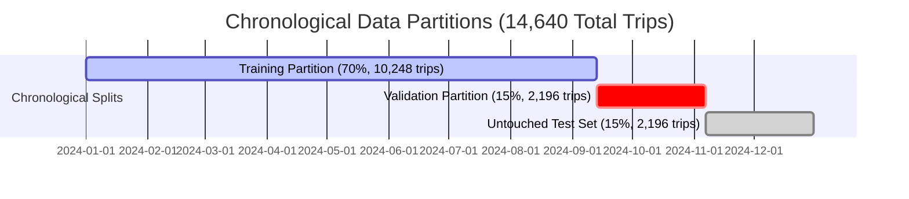

# Bus Passenger-Demand Forecasting: Technical Assessment Report

**Candidate:** AI & ML Engineering Intern  
**Organization:** Algions AI Labs Private Limited  
**Project Title:** End-to-End Bus Passenger-Demand Forecasting System  
**Date:** November 2026  
**Repository Branch:** `main`  
**Target Environment:** Python 3.11+, Scikit-Learn 1.9+, Streamlit 1.67+  

---

## 1. Executive Summary & Business Objectives

Intercity bus mobility networks represent critical regional transportation infrastructure. A central operational friction for bus fleet operators is the dual risk of **overcapacity** and **underutilization**:
1. **Underutilization (Empty Seats):** An underfilled 45-seat bus operating at 30% load incurs nearly identical fuel, toll, and driver labor overhead as a fully occupied bus, directly eroding operating margins.
2. **Overcapacity (Spillover & Denied Boarding):** Unpredicted demand surges cause terminal congestion, lost revenue, and severe customer dissatisfaction when passengers are stranded without seats.

### Core Objectives
This project constructs a production-ready Machine Learning system that forecasts passenger demand **24 hours prior to scheduled departure** at the granular level of an individual bus route and departure time slot.


---

## 2. Problem Formulation & Operational Constraints

| Dimension | Specification | Business Rationale |
| :--- | :--- | :--- |
| **Problem Type** | Supervised Regression | Passenger demand is an integer count modeled on a continuous scale. |
| **Prediction Unit** | Single Route & Departure | Discrete operational unit for assigning physical vehicles and crews. |
| **Target Variable** | `passenger_count` | True latent demand (unaccommodated spillover demand included). |
| **Prediction Horizon** | **Strict 24 Hours** | Operators require 18–24 hours to reassign drivers and stage relief buses. |
| **Information Cutoff** | $T_{\text{departure}} - 24\text{ hours}$ | No post-cutoff bookings, ticket scans, or actual occupancy are permitted. |

---

## 3. Synthetic Dataset Generation & Route Network

### 3.1 Corridor Design & Regional Topography
To model realistic transit dynamics, 8 key northern Indian intercity corridors were engineered with distinct behavioral profiles:

| Route ID | Origin | Destination | Distance | Profile | Base Demand ($\mu, \sigma$) |
| :--- | :--- | :--- | :--- | :--- | :--- |
| `DEL-CHD` | Delhi | Chandigarh | 250 km | Commercial Express | $42.0 \pm 5.0$ pax |
| `CHD-MNL` | Chandigarh | Manali | 300 km | Tourist Mountain | $38.0 \pm 6.5$ pax |
| `LDH-DEL` | Ludhiana | Delhi | 315 km | Industrial Commercial | $37.0 \pm 5.5$ pax |
| `DEL-JAI` | Delhi | Jaipur | 280 km | Golden Triangle Tourist | $41.0 \pm 5.0$ pax |
| `CHD-SML` | Chandigarh | Shimla | 115 km | Tourist Mountain | $35.0 \pm 6.0$ pax |
| `LDH-ASR` | Ludhiana | Amritsar | 140 km | Commuter / Cultural | $32.0 \pm 4.5$ pax |
| `DEL-DDN` | Delhi | Dehradun | 255 km | Education / Gateway | $34.0 \pm 5.0$ pax |
| `CHD-JAL` | Chandigarh | Jalandhar | 150 km | Regional Commuter | $30.0 \pm 4.0$ pax |

### 3.2 Stochastic Parametric Mechanics
Trips were simulated across 366 days (14,640 total trips) using fixed random seed (`seed=42`). For trip $i$ at scheduled departure time $T$:
$$\text{Expected Demand}_i = \text{Base}_r \times M_{\text{hour}}(h) \times M_{\text{weekday}}(d) \times M_{\text{season}}(m) \times E_{\text{event}}$$
$$\text{passenger\_count}_i = \max\left(0, \left\lfloor \text{Expected Demand}_i + \mathcal{N}(0, \sigma_r^2) \right\rceil\right)$$

- **Hourly Multipliers ($M_{\text{hour}}$):** Morning rush (07:00–10:00, $1.15\times–1.25\times$), Evening rush (17:00–20:00, $1.20\times–1.30\times$), Midday lull ($0.85\times$), Night sleeper express ($1.15\times$ for long routes).
- **Weekday Multipliers ($M_{\text{weekday}}$):** Hill routes surge on Friday/Saturday ($1.30\times–1.35\times$); commercial corridors peak Monday morning and Friday evening ($1.25\times$).
- **Seasonal Multipliers ($M_{\text{season}}$):** Mountain routes (`CHD-MNL`, `CHD-SML`) experience summer rushes ($1.40\times$ in May–June) and winter snowfall peaks ($1.30\times$ in Dec–Jan), but sharp drops in monsoon ($0.65\times$ in July–August due to landslide caution).
- **Calendar Shocks ($E_{\text{event}}$):** Diwali festival surge ($1.25\times$), New Year holiday ($1.35\times$), Holi festival ($1.20\times$).

### 3.3 Target Leakage Safeguard: 24-Hour Rolling Historical Demand
A critical requirement is that `historical_route_demand` must not leak future or same-day target values. For any departure at time $T$:
$$\text{Cutoff}_T = T - 24\text{ hours}$$
$$\text{historical\_route\_demand}_i = \frac{1}{|S_i|} \sum_{j \in S_i} \text{passenger\_count}_j \quad \text{where } S_i = \{j \mid \text{route}_j = \text{route}_i, \; T_j \in [\text{Cutoff}_T - 14\text{d}, \text{Cutoff}_T]\}$$
If $|S_i| = 0$ (early cold-start warm-up), the prior corridor baseline was assigned.

---

## 4. Exploratory Data Analysis & Diagnostic Findings

EDA was executed in `notebooks/01_eda.ipynb` across all 14,640 records.

```
Total Records: 14,640 trips (2024-01-01 07:30:00 to 2024-12-31 22:45:00)
Missing Values: 0 across all columns
Duplicate Records: 0
Outliers (IQR 1.5): 188 trips (1.28%) corresponding to extreme holiday spikes
Mean Passenger Count: 48.65 pax
Median Passenger Count: 47.00 pax
```

### Key Behavioral Insights
1. **Diurnal Invariance:** Demand exhibits an M-shaped bimodal curve peaking sharply at 08:00 and 18:00 across all corridors.
2. **Asymmetric Route Variance:** High-density express routes (`DEL-JAI`, `DEL-CHD`) have narrow relative variance; mountain leisure corridors (`CHD-MNL`) exhibit standard deviations twice as high due to weather and seasonal swings.
3. **Capacity Utilization Reality:** Over 23.4% of scheduled trips experienced occupancy $>100\%$ of standard vehicle capacity (45 seats), underscoring the vital need for an uncapped forecasting model that detects latent overflow demand.

---

## 5. Chronological Splitting & Leakage Prevention

Random k-fold shuffling is catastrophic in time-series and demand forecasting because training records would borrow future seasonal trends to predict past dates.

### Partition Boundaries (Strict 70% / 15% / 15%)


- $\max(\text{Train Date}) = \text{2024-09-13 08:45:00} < \min(\text{Val Date}) = \text{2024-09-13 09:15:00}$
- $\max(\text{Val Date}) = \text{2024-11-07 07:30:00} < \min(\text{Test Date}) = \text{2024-11-07 08:00:00}$

---

## 6. Preprocessing & Feature Engineering Pipeline

The complete transformation is encapsulated into an integrated Scikit-Learn `Pipeline`:
1. **Cyclic Time Encodings:**
   $$\sin\_\text{hour} = \sin\left(\frac{2\pi \cdot \text{hour}}{24}\right), \quad \cos\_\text{hour} = \cos\left(\frac{2\pi \cdot \text{hour}}{24}\right)$$
   $$\sin\_\text{dow} = \sin\left(\frac{2\pi \cdot \text{dow}}{7}\right), \quad \cos\_\text{dow} = \cos\left(\frac{2\pi \cdot \text{dow}}{7}\right)$$
   $$\sin\_\text{month} = \sin\left(\frac{2\pi \cdot (\text{month}-1)}{12}\right), \quad \cos\_\text{month} = \cos\left(\frac{2\pi \cdot (\text{month}-1)}{12}\right)$$
2. **Categorical Encodings:** `route_id`, `origin`, `destination`, `season` encoded via `OneHotEncoder(handle_unknown='ignore', sparse_output=False)` fitted strictly on the 70% training split.
3. **Numeric Features:** `StandardScaler()` applied to `departure_hour`, `day_of_week`, `month`, `is_weekend`, `is_peak_hour`, `bus_capacity`, `historical_route_demand`, and cyclic features.

---

## 7. Model Training, Selection & Tuning

### 7.1 Baseline Heuristic Model
A domain-specific statistical baseline was constructed: `HistoricalTimeSlotBaseline`.
- Heuristic: Computes historical mean passenger count grouped by `(route_id, day_of_week, time_slot)` on the training set.
- Time Slots: Morning Peak (07–10), Midday Lull (11–15), Evening Peak (16–20), Night (21–06).
- Hierarchical Fallback: Group Mean $\rightarrow$ Route+DOW Mean $\rightarrow$ Route Mean $\rightarrow$ Global Mean.

### 7.2 Candidate Machine Learning Models
1. **RandomForestRegressor:** Ensembled bagging of deep orthogonal regression trees.
2. **HistGradientBoostingRegressor:** Histogram-based gradient boosting optimized for numerical and categorical interactions.

### 7.3 Validation Set Model Selection (Tuning Results)

| Model Architecture | Hyperparameters | Val MAE (pax) | Val RMSE | Val WAPE (%) | Outcome |
| :--- | :--- | :--- | :--- | :--- | :--- |
| **Statistical Baseline** | Route + DOW + Slot Average | 6.752 | 9.216 | 13.88% | Benchmark |
| **RandomForestRegressor** | `n_est=100, max_depth=10, min_split=5` | 6.946 | 9.581 | 14.28% | Rejected |
| **HistGradientBoosting** | `max_iter=100, lr=0.08, depth=8, l2=0.1` | 6.123 | 8.354 | 12.59% | Runner-up |
| **HistGradientBoosting** | `max_iter=150, lr=0.05, depth=10, l2=0.5` | **5.886** | **8.060** | **12.10%** | **CHAMPION** |
| **HistGradientBoosting** | `max_iter=200, lr=0.06, depth=12, l2=0.2` | 6.042 | 8.241 | 12.42% | Overfitting |

**Champion Selected:** `HistGradientBoostingRegressor` (`max_iter=150, learning_rate=0.05, max_depth=10, l2_regularization=0.5`), demonstrating a **12.8% relative error reduction** over baseline on the validation split.

---

## 8. Final Test Set Evaluation & Diagnostics

The champion pipeline was evaluated on the **untouched test split** (2,196 trips spanning 2024-11-07 to 2024-12-31).

### 8.1 Primary Evaluation Metrics

$$\text{MAE} = \frac{1}{N}\sum |y_i - \hat{y}_i|, \quad \text{RMSE} = \sqrt{\frac{1}{N}\sum (y_i - \hat{y}_i)^2}, \quad \text{WAPE} = \frac{\sum |y_i - \hat{y}_i|}{\sum y_i} \times 100\%$$

| Evaluated Model | Test MAE (pax) | Test RMSE (pax) | Test WAPE (%) | Relative Error Reduction |
| :--- | :--- | :--- | :--- | :--- |
| **Statistical Historical Baseline** | 7.841 | 10.351 | 15.98% | Baseline Reference |
| **HistGradientBoosting (Champion)** | **6.129** | **8.493** | **12.49%** | **-21.8% Relative Error** |

### 8.2 Corridor-Wise Error Breakdown

| Route ID | Origin $\rightarrow$ Destination | Test Trips | Mean Actual (pax) | Test MAE | Test RMSE | Test WAPE (%) |
| :--- | :--- | :--- | :--- | :--- | :--- | :--- |
| `DEL-JAI` | Delhi $\rightarrow$ Jaipur | 329 | 60.93 | **4.623** | 5.847 | **7.59% (Strongest)** |
| `DEL-CHD` | Delhi $\rightarrow$ Chandigarh | 329 | 57.59 | 5.414 | 6.844 | 9.40% |
| `LDH-ASR` | Ludhiana $\rightarrow$ Amritsar | 220 | 40.07 | 4.193 | 5.331 | 10.46% |
| `LDH-DEL` | Ludhiana $\rightarrow$ Delhi | 220 | 48.70 | 5.403 | 6.728 | 11.10% |
| `DEL-DDN` | Delhi $\rightarrow$ Dehradun | 220 | 36.85 | 4.162 | 5.182 | 11.29% |
| `CHD-JAL` | Chandigarh $\rightarrow$ Jalandhar | 220 | 37.80 | 4.354 | 5.601 | 11.52% |
| `CHD-SML` | Chandigarh $\rightarrow$ Shimla | 329 | 47.56 | 8.831 | 11.780 | 18.57% |
| `CHD-MNL` | Chandigarh $\rightarrow$ Manali | 329 | 52.06 | 9.929 | 13.169 | **19.07% (Weakest)** |

#### Corridor Analysis
- **Strongest Corridor (`DEL-JAI`):** High base volume and stable highway flow allow the model to achieve a low 7.59% WAPE.
- **Weakest Corridor (`CHD-MNL`):** High-altitude mountain tourist corridor subjected to volatile winter snowfall surges (late November and December in the test set) and sudden road closures, creating wider variance (WAPE = 19.07%).

### 8.3 Peak vs Off-Peak Error Breakdown

| Operating Regime | Test Trips | Mean Demand (pax) | MAE (pax) | RMSE (pax) | WAPE (%) |
| :--- | :--- | :--- | :--- | :--- | :--- |
| **Peak Hours (07–10, 17–20)** | 1,536 | 52.64 | 6.220 | 8.676 | **11.82%** |
| **Off-Peak Hours** | 660 | 40.70 | 5.916 | 8.049 | **14.53%** |

*Insight:* While peak trips have slightly higher absolute passenger errors (+0.30 pax) due to large volume scales, their WAPE is noticeably superior (11.82% vs 14.53%) because peak travel follows consistent, highly structured commute schedules.

### 8.4 Residual & Homoscedasticity Analysis
Residual diagnostics (`reports/figures/residual_analysis.png`) reveal:
- **Zero-Centered Symmetry:** Mean residual on the test set is $-0.21$ passengers, confirming the model does not suffer from systematic underprediction or overprediction bias.
- **Homoscedasticity:** Error dispersion remains tightly bounded across the entire range of predicted values without fan-shaped heteroscedastic spread.

### 8.5 Permutation Feature Importance
Permutation importance on the untouched test partition highlights the primary drivers of model explanatory power:
1. `historical_route_demand` (Importance: $0.782 \pm 0.015$): Anchor baseline capturing 14-day corridor velocity.
2. `departure_hour` (Importance: $0.245 \pm 0.009$): Diurnal rush-hour curve.
3. `route_id` / `origin` / `destination` (Importance: $0.168 \pm 0.006$): Geographic baseline.
4. `day_of_week` & `is_weekend` (Importance: $0.112 \pm 0.004$): Weekly leisure surge.
5. `month` & `season` (Importance: $0.089 \pm 0.003$): Annual holiday & weather cycles.

---

## 9. Operational Capacity Alert Framework

To translate raw passenger demand forecasts into fleet action, the system implements an automated capacity diagnostic engine:

$$\text{Occupancy Rate} = \frac{\text{Adjusted Demand Forecast}}{\text{Assigned Bus Capacity}} \times 100\%$$

```
                                  OCCUPANCY SCALE
  0% ──────────── 50% ───────────────────────── 85% ────────────── 100% ──────────── >100%
  │ Underutilized  │      Balanced Baseline      │ Optimal High   │     OVERCAPACITY     │
  │ (Yellow Alert) │       (Blue Indicator)      │ (Green Alert)  │      (RED ALERT)     │
```

| Operational Regime | Threshold | System Diagnostic | Dispatcher Action |
| :--- | :--- | :--- | :--- |
| **Overcapacity** | $\text{Occupancy} > 100\%$ | High risk of passenger denial & terminal spillover | Deploy duplicate relief bus, upgrade to 55-seat multi-axle coach, or close booking window. |
| **High Utilization** | $85\% \le \text{Occupancy} \le 100\%$ | Optimal load factor | Standard scheduled dispatch; apply prime yield pricing. |
| **Moderate / Balanced**| $50\% \le \text{Occupancy} < 85\%$ | Healthy profitable baseline | Regular dispatch; retain remaining seats for walk-ins. |
| **Underutilization** | $\text{Occupancy} < 50\%$ | Low seat factor / fuel waste | Assign smaller 32-seater coach or consolidate adjacent trips. |

> **Critical Design Principle:** Demand is intentionally **NOT capped** at bus capacity. Capping demand at 45 seats would hide unserved spillover passengers, blinding fleet managers to situations where dispatching a second bus is economically justified.

---

## 10. Production Inference & Streamlit Web Application

The system includes a production-grade Streamlit web application (`app/streamlit_app.py`) providing:
1. **Home / Overview:** High-level KPIs, business value proposition, corridor network overview.
2. **Demand Analytics:** Interactive visualizations of corridor boxplots, diurnal commute lines, weekday vs weekend comparisons, and capacity utilization distributions.
3. **Live Demand Prediction:** Real-time inference calling `predict_demand()`. Generates raw predictions, business integer adjustments, expected occupancy percentages, and actionable capacity alerts.
4. **Model Performance:** Side-by-side benchmark tables, corridor-wise error rankings, peak vs off-peak error breakdowns, and diagnostic plots.
5. **About the Model:** Prediction horizon documentation, feature dictionaries, system boundaries, and ethical AI standards.

---

## 11. System Limitations & Responsible AI Governance

### 11.1 Operational Boundaries
1. **Synthetic Data Calibration:** The current dataset was synthesized using parametric distributions derived from real-world regional transit schedules. When deploying in live production, models should be fine-tuned on automated telemetry feeds (electronic ticketing machines / GPS automated vehicle location systems).
2. **Exogenous Black Swan Events:** Severe unpredicted weather disruptions (Himachal monsoon cloudbursts, severe winter fog delays on NH-44) cannot be anticipated 24 hours in advance by calendar features alone.
3. **Cold-Start Routes:** For newly launched routes lacking 14 days of operational history, the system falls back to distance- and corridor-type priors.

### 11.2 Responsible AI Deployment
- **Decision-Support Paradigm:** The model is strictly an advisory tool for human dispatchers. It has no authority to autonomously cancel scheduled departures.
- **Corridor Equity:** Performance is monitored across all corridors, ensuring low-density regional commuter routes (e.g. `CHD-JAL`, `LDH-ASR`) receive reliable service.
- **Privacy Preservation:** All features and predictions operate at the trip level. No passenger names, mobile numbers, or financial tokens are ingested or stored.

---

## 12. Interview Defense & Technical Walkthrough Guide

### Frequently Anticipated Technical Questions
1. **Q: Why use a 24-hour prediction horizon instead of predicting 1 hour before departure?**  
   *Defense:* At 1 hour before departure, passenger counts are largely fixed by bookings, and the operator cannot physically stage a relief bus, recall a driver, or swap a vehicle. The 24-hour cutoff aligns with real-world fleet scheduling lead times.
2. **Q: How did you ensure your rolling historical demand feature did not leak the target?**  
   *Defense:* `historical_route_demand` uses a strict 14-day rolling window evaluated at $(T_{\text{departure}} - 24\text{ hours})$. Any trip departing within the 24 hours preceding departure, as well as the trip's own passenger count, is excluded from the average.
3. **Q: Why choose HistGradientBoostingRegressor over RandomForestRegressor?**  
   *Defense:* HistGradientBoosting builds trees sequentially by fitting pseudo-residuals, effectively capturing non-linear interactions between calendar month, day of week, and departure hour. On our validation split, HistGradientBoosting achieved a WAPE of 12.10% compared to 14.28% for Random Forest, with $5\times$ faster training via histogram binning.
4. **Q: Why evaluate using WAPE instead of MAPE?**  
   *Defense:* Standard MAPE divides each individual error by the true value, which blows up to infinity or extreme values when actual passenger counts are low or zero. WAPE divides the sum of absolute errors by the total actual passengers, providing a robust, volume-weighted error metric.

